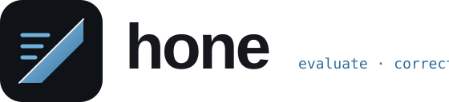

<p align="center">
  <picture>
    <source media="(prefers-color-scheme: dark)" srcset=".github/assets/logo.svg">
    
  </picture>
</p>

<p align="center">
  <b>Evaluate. Correct. Sharpen.</b><br>
  hone measures an AI system on your cases, finds why it fails, tries changes,<br>
  and keeps only what holds up on cases the changes never saw.
</p>

<p align="center">
  <a href="https://github.com/kyu1204/hone/actions"></a>
  <a href="./LICENSE"></a>
</p>

> **Status:** v0.1.0, not on npm yet: [install from source](#install). Built in public: the plan is in [`WORKPLAN.md`](./WORKPLAN.md), every task landed as a pull request you can read, and [`CHANGELOG.md`](./CHANGELOG.md) lists what shipped.

---

## Three commands

```bash
hone init       # set up: finds what the project is, writes hone.config.ts and example cases
hone test       # evaluate: every case, several times, and how far to trust the score
hone sharpen    # improve: why cases fail, each change tried, a verdict on cases no change saw
```

`hone` alone opens the results in the terminal. Every other command is one step of these three or a tool, and stays out of the way until you ask: `hone help all`.

<p align="center"></p>

This is `hone sharpen` on [`examples/sharpen`](./examples/sharpen/), a toy help-desk bot in which nothing passes as written (real output, 15 seconds, four model calls):

```
Now: 0% of 12 cases pass. 6 more cases are held out for the final check.
Why it fails:
  1. unwarranted-refusal-idk (6 of 12 failed trials, e.g. cancel)
     The assistant gives a generic 'Sorry, I do not know' reply instead of attempting the task, s...
  2. boilerplate-answer-wrapper (5 of 12 failed trials, e.g. ship-abroad)
     The assistant wraps its answer in a fixed conversational template (e.g. "Thanks for asking!...
  3. conversational-filler-wrapping (1 of 12 failed trials, e.g. shipping-time)
     The assistant surrounds the answer with pleasantries or framing such as 'Thanks for asking!...
  Examples of each, and how to write a change: .hone/sharpen/20261013151659-diagnosis.md
Tried 3 changes:
  - loose matching               0% -> 0%   questions with extra words around them find nothing,...
  + rewrite 1                    0% -> 50%   Forbids refusals and boilerplate wrappers, and tells...
  + loose matching on rewrite 1  0% -> 100%
Result: PROVEN. On 6 cases it never saw, loose matching on rewrite 1 takes the pass rate from 0% to
100% (+100 points, 95% interval +100 to +100, p = 0.03).
The new text is in .hone/sharpen/20261013151659-best.txt
As a change file: .hone/sharpen/20261013151659-best.ts
It uses the change "loose matching" from sharpen/loose-matching.ts.
```

Before trying anything it held six cases out. It named the failure modes, tried the change from a file (no gain alone), asked a model to rewrite the prompt (half), put the change on top of the rewrite (all), and checked the result on the six cases no proposal had seen.

### What the verdict means

| verdict | what it says | what to do |
|---|---|---|
| `PROVEN` | better on the held-out cases, by a paired test and an exact sign test | adopt the change |
| `PROMISING, not proven` | better on the held-out cases, but too few of them to rule out chance; the account says how many would settle it | add cases, do not call it an improvement |
| `NO GAIN` | nothing beat what you have, or the best one only fitted the cases it learned from | keep what you have |

The cycle is built to say no:

- A third of the cases is held out before anything is tried, and no proposal sees them.
- A held-out set wears out. The second different change it judges has to reach p < 0.025, the third p < 0.017, and the account says so.
- Cost counts. The search runs at your system's price, and a candidate that costs clearly less and is within one case of the best is the winner: a larger model has to earn its place.
- When more than a fifth of the trials error, it stops with "cannot measure": an error is not a wrong answer.

## Your own agent

The case most teams have: an in-house agent with tools and house rules, built with LangChain, Strands or plain Python, and no way to tell whether the last prompt edit made it better. hone calls one function:

```python
# hone_target.py, written by `hone init` in a project that depends on langchain, langgraph or strands-agents
def answer(input, ctx):
    agent = build_agent(ctx.params["system_prompt"])          # your agent
    result = agent.invoke({"messages": [{"role": "user", "content": input}]})
    return ctx.from_langchain(result["messages"])             # ctx.from_strands(agent.messages, usage) for Strands
```

`ctx.from_langchain` and `ctx.from_strands` record the conversation: every tool call with its arguments, every tool result, the tokens and what they cost. So a case can say what must hold in it, not only what the answer looks like:

```json
{
  "id": "sec-lost-laptop",
  "input": { "from": "sara.cho@acme.example", "message": "I left my work laptop on the subway this morning." },
  "expected": {
    "tools": ["create_ticket"],
    "args": { "create_ticket": { "category": "security", "priority": "urgent" } },
    "says": ["security@acme.example"]
  }
}
```

The system prompt comes from `params` in the config, which is what lets a change replace it without touching your code.

[`examples/helpdesk-agent`](./examples/helpdesk-agent/) is such an agent, the same one in LangChain and in Strands: six tools, a one-line prompt, 36 cases over six house rules. Measured once per arm, on 12 held-out cases ([`docs/benchmarks/custom-agents.md`](./docs/benchmarks/custom-agents.md)):

| | hone's own model writes the rewrites | Codex writes the change files, hone only judges |
|---|---|---|
| LangChain | PROMISING: 50% to 83% | **PROVEN: 42% to 96%**, 1.1x the cost per case |
| Strands | **PROVEN: 42% to 100%**, 1.8x the cost per case | PROMISING: 33% to 83% |

The two that were not proven are the point. Both prompts scored 90% and 92% on the cases they were written from. One had got the priority of security incidents wrong. The other told the agent to "complete the escalation now rather than asking permission", and on a held-out case the agent reset a password without asking for the employee ID. A team looking at "52% to 92%" would have shipped it.

Twelve held-out cases that share six rules are thin evidence, one run per arm says nothing about frameworks, and the report says so at length. It also lists what the first runs got wrong in hone itself, each of which became a fix; the left column is the result after those fixes.

## Changes are files

What `hone sharpen` tries are changes: files under `sharpen/`, one idea each, with the reason.

```ts
// sharpen/cite-policies.ts
import { change } from "hone-eval";

change("cite the policy id", {
  why: "answers quote the policy text but never name the policy",
  add: "When an answer comes from a policy, name its id in square brackets, like [P-03].",
});
```

| field | what it is |
|---|---|
| `why` | the hypothesis: which failure, and why this fixes it. Required |
| `add` | one paragraph for the text as it is: a rule, an instruction. Additions that help are stacked into one text |
| `text` | the whole new text: a prompt, a rule file, a rubric |
| `config` | anything a config can express: a setting, a model, another function or module for a target |

A person writes them, or a coding agent that read the diagnosis; the cycle treats both the same, and a model's own rewrite is saved in the same form. Two rules are two changes: the cycle tries each alone, stacks the ones that help, puts a config change on top of the best text, and says what each was worth.

### With a coding agent

`hone init` installs a skill that Claude Code, Codex and Cursor pick up (`.agents/skills/hone`, `.claude/skills/hone`) and registers an MCP server for Claude Code (`.mcp.json`) and Cursor (`.cursor/mcp.json`); Codex takes the server from its own config (`mcp_servers.hone`). The skill teaches the agent the loop a person follows: `hone sharpen --budget 0`, read the diagnosis page it names, write one change file per hypothesis, run `hone sharpen`, report the verdict as printed. The agent proposes; hone holds cases out and decides. `hone guide` prints the skill.

`hone serve mcp --no-rewrites` is a server that only judges. It holds the API keys the system under test needs, so the agent's own shell does not have to, and it never lets hone's model propose anything.

Checked with real sessions, each given one request and the skill:

- Two Codex sessions on the helpdesk agent (the right column above). Sandboxed without network, they reached hone only through the MCP server. Neither opened the case files. One applied its proven prompt; the other reported "promising, not proven" and left the project alone.
- One Claude Code session on the toy bot ([`docs/benchmarks/agent-writes-changes.md`](./docs/benchmarks/agent-writes-changes.md)): two change files, confirmed together on six held-out cases in 31 seconds, with no model of hone's own available.

## Other systems

A target is what gets evaluated, and every result is a trace of messages and spans that scorers read.

| the system | target | example |
|---|---|---|
| a RAG service or any endpoint | `http` | [`examples/rag-python`](./examples/rag-python/) |
| a Python agent or function | `python` | [`examples/helpdesk-agent`](./examples/helpdesk-agent/) |
| a TypeScript function | `fn` | [`examples/qa-fn`](./examples/qa-fn/) |
| a coding agent on the command line (Claude Code, Codex, OpenCode, Aider) in an isolated copy of a workspace | `process` | [`examples/agent-claude-code`](./examples/agent-claude-code/), [`examples/harness-ablation`](./examples/harness-ablation/) |
| a tool on an MCP server | `mcp` | [`examples/mcp-server`](./examples/mcp-server/) |
| sessions you already have | `replay` | `hone import claude-code` |

```ts
import { defineConfig } from "hone-eval";

export default defineConfig({
  targets: {
    rag: { kind: "http", url: "http://localhost:8000/ask", body: (c) => ({ q: c.input }), output: "answer" },
  },
  cases: "evals/**/*.yaml",
  trials: 3,
  scorers: [{ name: "contains", caseField: "expected.answer" }, { name: "rag.citations" }],
  gates: { passAt1: { min: 0.8 } },
});
```

Every case runs several trials, so a score comes with an interval, and two versions are compared with a paired test. Scorers are deterministic checks, RAG checks (citations, faithfulness, recall), a reward-hack detector for coding agents, and judges that can themselves be checked: `hone calibrate` injects faults into passing runs and reports how many the judge catches. Target outputs and verdicts are cached by content, so changing a scorer calls nothing upstream again. `hone test --ci` turns the gates into an exit code, JUnit and a pull request comment.

The single steps of the cycle are commands too (`hone ablate`, `hone compare`, `hone bisect`, `hone fork`, `hone cluster`), and `hone` opens a terminal dashboard built on [OpenTUI](https://github.com/anomalyco/opentui): matrix, trace viewer, trajectory diff, failure clusters, judge calibration. `hone serve ssh` serves it read-only.

## Evidence so far

Three studies and one demonstration. Each is one system, and each report says what it does not show.

**An in-house agent in two frameworks** ([report](./docs/benchmarks/custom-agents.md)). The table above. The cycle ran with no person in it, and with a coding agent as the proposer. The held-out cases share their rules with the cases the prompts were written from, the starting prompt was one line, and the author of hone wrote the agent and its cases.

**A citation RAG over Korean policy documents** ([report](./docs/benchmarks/rag-policy-qa.md)). On [`kyu1204/rag_qa_eval`](https://github.com/kyu1204/rag_qa_eval), 43 questions with the project's own scoring, 3 trials per case:

| system | useful | safe | paired vs baseline (useful) |
|---|---|---|---|
| baseline prompt, top_k 5 | 79.8% | 100% | |
| the authors' hand-tuned best (prompt v3, top_k 30) | 87.6% | 97.7% | +7.8 pts, p = 0.049 |
| prompt evolved by `hone evolve`, top_k 30 | 88.4% | 100% | +8.5 pts, p = 0.047 |

A rewrite from failure clusters matched a week of hand tuning. But a person still drove it: the retrieval depth was the authors' find and a person combined it with the rewrite, the interval starts at +0.1 and does not survive a correction for three comparisons, and the prompt was written and confirmed on the same 43 questions. `hone sharpen` was built afterwards to close those gaps. This study has not been run through it yet.

**Claude Code on 15 tasks from this repository** ([report](./docs/benchmarks/agent-harness.md)). Graded by tests the agent never sees:

| what the agent got | resolved | est. cost per solved task |
|---|---|---|
| Sonnet, commit title and test names | 24% | $0.44 |
| Sonnet, the same plus six harness rules | 31% | $0.54 |
| Opus, commit title and test names | 49% | $1.06 |
| Sonnet, written requirements | 100% | $0.08 |

The thing about to be tuned, the harness rules, was not the lever: the hidden tests asserted names the task statement never gave. Here hone was the instrument, not the fixer. It ran and scored the sessions and named the failure modes; a person read the traces and found the cause.

## Next to other tools

promptfoo, DeepEval, Inspect and Harbor are older, larger and in daily use by many people. hone has no users yet. They have more providers, more ready-made metrics and benchmarks, web interfaces and hosted options; if you want to score outputs against a rubric or run a published benchmark, start there.

hone is for the step after the score: which change to make, and whether it really helped. What it does in one command, and what its author did not find elsewhere as one command, is the cycle above with the held-out check, with changes as files that a person or an agent writes. It reads and writes the others' formats (Inspect logs, Docent collections, Harbor results, Claude Code sessions, `claude plugin eval` suites; OpenTelemetry GenAI spans, RL rollouts), so it can sit next to them.

## Install

Requires [Bun](https://bun.sh) 1.3.14 or newer. The package is not on npm yet, so install it from a clone:

```bash
git clone https://github.com/kyu1204/hone && cd hone && bun install && bun run build

cd /path/to/your/project
bun add -d /path/to/hone      # the package is named hone-eval, the command is hone
bunx hone init
bunx hone test
```

A Python target needs `python3`; the generated config uses the project's `.venv` when there is one. `hone init` asks for API keys and stores them in `~/.config/hone/env`; `hone sharpen` needs one (Anthropic or OpenAI) only for its own rewrites and for naming failure modes, and runs your change files without.

## Documentation

- [`docs/README.md`](./docs/README.md): index; [`docs/concepts.md`](./docs/concepts.md): the data model and the loop
- [`docs/cli.md`](./docs/cli.md): every command, generated from `--help`; the three everyday ones first
- [`docs/config.md`](./docs/config.md): `hone.config.ts`, targets, scorers, gates, and the `sharpen` block
- [`docs/correction.md`](./docs/correction.md): `hone sharpen` step by step, and its single steps: fork, evolve, optimize, ablate, bisect, compare
- [`docs/analysis.md`](./docs/analysis.md): clustering, taxonomy, trajectory diff, judge calibration, branch points
- [`docs/serve.md`](./docs/serve.md): ssh dashboard, reward API, MCP server
- [`docs/formats.md`](./docs/formats.md) and [`docs/compat.md`](./docs/compat.md): import and export formats with sources
- [`examples/`](./examples/): sharpen (the three commands on a toy that starts broken), helpdesk-agent (an in-house agent with tools, in LangChain and in Strands), qa-fn, rag-python, agent-claude-code, mcp-server, harness-ablation
- [`skills/hone/`](./skills/hone/SKILL.md): the skill `hone init` installs for coding agents, a short router with topic references (`hone guide <topic>`)

## Architecture in one paragraph

Four layers. **Surfaces** (TUI, CLI, MCP, reward server, SSH, reports) talk to the **Engine** (plan, scheduler, executor, cache, scorers, store, stats) and to **Correction** (cluster, calibrate, fork, evolve, optimize, bisect, sharpen). The Engine talks to **Adapters** (targets, importers, exporters, model providers). Only `providers/` touches the network, so the whole thing runs offline in tests with one stub. Results live in `.hone/` as JSON, with a SQLite index that can be rebuilt at any time.

## Contributing

Issues with real eval pain are the most useful thing you can send: a trace that fooled your judge, an agent you could not wire in, a verdict you do not believe. Pull requests are welcome; see [`CONTRIBUTING.md`](./CONTRIBUTING.md). Contributions are signed off under the DCO, there is no CLA.

## License

[Apache-2.0](./LICENSE). The `hone` name and logo are not covered by the license.
